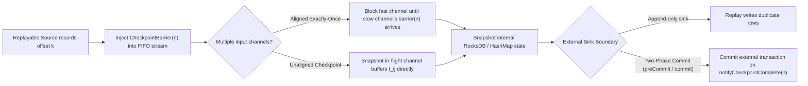

## Chandy-Lamport Barriers and the Two-Phase Commit Sink Boundary

The [Checkpoint and Recovery Lab](checkpoint-recovery.md) proves that an internal `ValueState` accumulator and a replayable source cursor recover to a mutually consistent cut after task failure. Conversely, the [Flink ClickHouse Sink Tutorial](../connectors/clickhouse-sink.md) proves that replaying a bounded job against an external append-only table duplicates rows (`5 rows -> 10 rows`).

This page connects those two labs through distributed-systems theory (**MIT 6.5840** and **CMU 15-445**):

> Why does a checkpoint barrier guarantee an exact cut across internal operator state without stopping the world, and why does that guarantee stop at the boundary of an external storage engine?

### 1. From Chandy-Lamport markers to Flink Checkpoint Barriers

In the classic **Chandy-Lamport (1985)** distributed snapshot algorithm over FIFO channels:

1. A process records its local state $S_i$ upon receiving the first marker `<M>` on any incoming channel $c_{ki}$.
2. Because another incoming channel $c_{ji}$ ($j \neq k$) may still carry messages sent *before* process $j$ took its snapshot, process $i$ must record all messages arriving on $c_{ji}$ until `<M>` arrives on $c_{ji}$ as the **channel state** $I_{ji}$.

Flink's **Asynchronous Barrier Snapshotting (ABS)** adapts Chandy-Lamport to acyclic dataflow graphs (`DAGs`) in two distinct modes:

| Snapshot Mode | How channel state $I_{ji}$ is handled | Operational trade-off |
| --- | --- | --- |
| **Aligned Checkpoints (Default `EXACTLY_ONCE`)** | When `CheckpointBarrier(n)` arrives on fast input channel $c_{ki}$, the operator buffers further records from $c_{ki}$ without processing them until `CheckpointBarrier(n)` arrives on *every* input channel $c_{ji}$. | $I_{ji} = \emptyset$ (tiny checkpoint metadata), but under severe backpressure the barrier wait stalls the fast channel and inflates p99 latency. |
| **Unaligned Checkpoints** | Upon seeing the first `CheckpointBarrier(n)`, the operator immediately forwards the barrier downstream and snapshots the unread input/output network buffers alongside its operator state. | Equivalent to full Chandy-Lamport ($I_{ji} \neq \emptyset$); checkpoint duration stays fast under backpressure at the cost of larger snapshot I/O. |
| **At-Least-Once Barrier Mode** | The operator continues processing records from fast channel $c_{ki}$ while waiting for slow channel $c_{ji}$'s barrier, then snapshots local state once all barriers arrive. | Post-barrier records from $c_{ki}$ are baked into snapshot $n$; if the job rolls back to $n$, those records are replayed a second time. |

### 2. Why checkpoint rollback stops at the external sink

Inside the Flink runtime ([`CheckpointRecoveryLabTest.java`](https://github.com/azusachino/flos/blob/main/modules/flink/checkpoint-recovery-lab/src/test/java/io/github/azusachino/flos/flink/recovery/CheckpointRecoveryLabTest.java)), recovery simply discards the failed attempt's in-memory mutations and reloads checkpoint $n$'s `nextEventIndex = 3` and `total = 21.50`.

An external database or message broker (`ClickHouse`, `Kafka`, `PostgreSQL`) does not automatically roll back its committed tables when Flink's `JobManager` restores an earlier checkpoint. To achieve end-to-end **effectively-once** output across the process boundary, a pipeline must choose one of two architectural contracts:

#### Contract A: Idempotent / Upsert Sinks (Deterministic Key Deduplication)

Instead of coordinating distributed transactions, every emitted record carries a deterministic natural key (such as `(customer_id, window_end)` or `event_id`). When Flink rolls back to checkpoint $n$ and replays records $[n, \text{crash}]$, the downstream store overwrites or deduplicates the replayed keys.

- **Pros:** No long-lived external transactions; works with append/merge engines once compaction or `FINAL` deduplication runs.
- **Cons:** Readers querying an eventually deduplicated store (such as ClickHouse `ReplacingMergeTree` before background merge) can transiently observe duplicate versions unless queries account for it.

#### Contract B: Two-Phase Commit (`SinkV2` `SupportsCommitter`)

Flink acts as the **Two-Phase Commit (`2PC`) Coordinator** tied to checkpoint barriers:

1. **Phase 1 — Prepare (`preCommit` on Barrier $n$):** When `CheckpointBarrier(n)` reaches the sink writer, the writer flushes buffered records into an isolated external transaction $T_n$ (or temporary staging file), prepares $T_n$, and persists the transaction handle inside Flink's checkpoint $n$ state.
2. **Global Commit Decision:** The `CheckpointCoordinator` on the JobManager waits until *every* operator in the topology acknowledges checkpoint $n$.
3. **Phase 2 — Commit (`notifyCheckpointComplete(n)`):** Once the checkpoint metadata is durable, Flink invokes `Committer.commit(T_n)` on the sink to make transaction $T_n$'s rows visible to external readers.

### 3. The 2PC failure window to watch in production

Because Two-Phase Commit is a blocking protocol (**MIT 6.5840**), any `2PC` sink introduces a critical operational coupling between Flink's checkpoint interval and the external system's transaction timeout:

- **Visibility latency equals the checkpoint interval:** External consumers cannot read committed rows faster than Flink completes checkpoints.
- **Recovery between `preCommit` and `commit`:** If a task crashes *after* checkpoint $n$ succeeds on the JobManager but *before* `notifyCheckpointComplete(n)` finishes committing $T_n$, the restored job must re-read $T_n$'s handle from checkpoint $n$'s state and complete the commit before processing new barriers. If the external broker's `transaction.timeout.ms` expires during a prolonged Flink outage, the prepared transaction $T_n$ is aborted externally and data loss occurs unless alerted and reconciled.

### Related labs in this repository

- [Checkpoint and Recovery Lab](checkpoint-recovery.md) — proves internal barrier consistency (`nextEventIndex` + window accumulator).
- [Savepoint and Parallelism Upgrade Lab](savepoint-upgrade.md) — proves key-group state redistribution across planned upgrades.
- [Flink ClickHouse Sink Tutorial](../connectors/clickhouse-sink.md) — demonstrates append-only replay amplification (`5 -> 10 rows`) when a sink has neither `2PC` transactions nor idempotent key deduplication.
